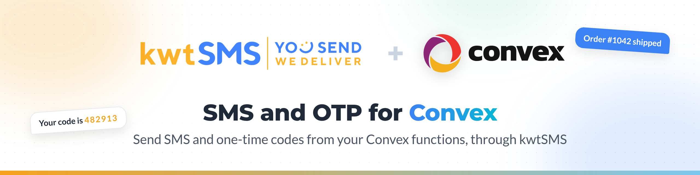

<picture>
  <source media="(prefers-color-scheme: dark)" srcset=".github/assets/readme-header-dark.png">
  
</picture>

# kwtsms-convex

[](https://github.com/kwtsms/kwtsms-convex/actions/workflows/ci.yml)
[](LICENSE)

A [Convex](https://convex.dev) component that sends SMS and OTP codes through kwtSMS, the Kuwaiti SMS gateway. Queued sending, message status, caps against abuse, English and Arabic OTP texts, and test mode by default.

All kwtSMS integrations: [kwtsms.com/integrations](https://www.kwtsms.com/integrations/)

## About kwtSMS

kwtSMS is a Kuwaiti SMS gateway trusted by top businesses to deliver messages anywhere in the world, with private Sender ID, free API testing, non-expiring credits, and competitive flat-rate pricing. Secure, simple to integrate, built to last. Open a free account in under 1 minute, no paperwork or payment required. [Click here to get started](https://www.kwtsms.com/cportal/signup/)

## Install

```bash
npm install kwtsms-convex
```

Requires Convex 1.50 or newer.

## Set up

`convex/convex.config.ts`: the component cannot read your `process.env`, so hand the three values over from your app's own env.

```ts
import { defineApp } from "convex/server";
import { v } from "convex/values";
import kwtsms from "kwtsms-convex/convex.config.js";

const app = defineApp({
  env: {
    KWTSMS_USERNAME: v.string(),
    KWTSMS_PASSWORD: v.string(),
    KWTSMS_SENDER_ID: v.string(),
  },
});
app.use(kwtsms, {
  env: {
    KWTSMS_USERNAME: app.env.KWTSMS_USERNAME,
    KWTSMS_PASSWORD: app.env.KWTSMS_PASSWORD,
    KWTSMS_SENDER_ID: app.env.KWTSMS_SENDER_ID,
  },
});
export default app;
```

```bash
npx convex env set KWTSMS_USERNAME your_api_username
npx convex env set KWTSMS_PASSWORD your_api_password
npx convex env set KWTSMS_SENDER_ID KWT-SMS
```

These are your kwtSMS API credentials (not your account mobile number). The component never stores them and never logs them.

## Test mode first

`testMode` is **on by default**. Every send goes to kwtSMS with `test=1`: the gateway accepts and queues the message, nothing reaches a handset, and the credits stay held until you delete the test message from your queue in the kwtSMS portal. Nothing is delivered until you pass `testMode: false`.

## Use

```ts
// convex/sms.ts
import { components, internal } from "./_generated/api";
import { mutation, query, internalMutation } from "./_generated/server";
import { v } from "convex/values";
import { Kwtsms, vSmsEvent } from "kwtsms-convex";

export const kwtsms = new Kwtsms(components.kwtsms, {
  // testMode: false,                      // go live
  // allowedCountries: ["965"],            // default
  onSmsEvent: internal.sms.onSmsEvent,    // optional
});

export const send = mutation({
  args: { to: v.string(), text: v.string() },
  handler: async (ctx, args) => {
    // to: 965XXXXXXXX, +965 XXXX XXXX, 00965..., 8-digit local, Arabic or Persian digits
    return await kwtsms.sendSms(ctx, { ...args, idempotencyKey: "welcome-user-42" });
  },
});

export const status = query({
  args: { id: v.string() },
  handler: async (ctx, args) => kwtsms.getStatus(ctx, args.id as never),
});

export const onSmsEvent = internalMutation({
  args: { id: v.string(), event: vSmsEvent },
  handler: async (ctx, { id, event }) => {
    // event.status: "queued" | "sending" | "sent" | "failed", plus msgId, points, errorCode
  },
});
```

`sendSms` returns the message id at once; the send itself runs in a background queue ([`@convex-dev/workpool`](https://www.convex.dev/components/workpool)). A repeated `idempotencyKey` returns the existing id and sends nothing new.

### Status

| Status | Meaning |
| --- | --- |
| `queued` | Saved, waiting for a worker |
| `sending` | The request is going to kwtSMS |
| `sent` | **Accepted by the gateway.** This is not proof of handset delivery |
| `failed` | Refused or errored. `errorCode` holds the kwtSMS `ERR` code (for example `ERR003`) |

`getStatus` also returns `msgId`, `points` (credits charged) and `balanceAfter`. A message is refused before it is saved, with a `ConvexError({ code })`, when the code is one of `INVALID_PHONE`, `COUNTRY_NOT_ALLOWED`, `EMPTY_MESSAGE`, `INVALID_CODE`, `RATE_LIMIT_NUMBER`, `RATE_LIMIT_GLOBAL` or `DAILY_CAP`.

### Options

| Option | Default | Meaning |
| --- | --- | --- |
| `testMode` | `true` | `true` sends `test=1`, `false` delivers |
| `allowedCountries` | `["965"]` | Country calling codes that may receive SMS |
| `perNumberPerHour` | `5` | Messages per phone number per hour |
| `globalPerHour` | `100` | Messages per hour for the whole app |
| `dailyPointsCap` | `500` | Points per 24 hours |
| `onSmsEvent` | none | Internal mutation `(ctx, { id, event })`, called on every state change |

The caps are counted from the component's own table, so they hold across restarts and instances.

### Retries and double sends

Nothing is sent twice. The only retry is for an error that happens before the request leaves your deployment (DNS or connection refused), up to 3 tries. Once kwtSMS may have seen the request (any answer, an `ERR` code, or a timeout after sending) the result is final: the message is marked `failed` and is never retried, so credits are never charged twice.

## OTP

```ts
export const sendCode = mutation({
  args: { to: v.string() },
  handler: async (ctx, args) => {
    const code = String(crypto.getRandomValues(new Uint32Array(1))[0] % 1000000).padStart(6, "0");
    // Store a hash of `code` with an expiry in your own auth tables, then:
    await kwtsms.sendOtp(ctx, { to: args.to, code, lang: "ar", appName: "Shop" });
  },
});
```

The OTP texts are `Shop: your code is 123456. Valid 5 min. Do not share it.` and an Arabic text, each one SMS part. The code and the message are **not stored**: the message row keeps `[otp]` and the length only, and nothing is logged.

**Put `sendOtp` behind your own auth and rate limits.** Anyone who can call it can make your app send SMS to any number in `allowedCountries`. The caps above limit the damage; they do not replace your own checks.

### Convex Auth phone provider

```ts
import { Phone } from "@convex-dev/auth/providers/Phone";
import { kwtsms } from "./sms";

export const KwtsmsPhone = Phone({
  id: "kwtsms",
  maxAge: 5 * 60,
  async sendVerificationRequest({ identifier, token }, ctx) {
    await kwtsms.sendOtp(ctx, { to: identifier, code: token });
  },
});
```

Check the code length your provider makes: `sendOtp` accepts 4 to 8 digits.

## Balance

```ts
const { available, purchased } = await kwtsms.balance(ctx); // ctx must be an action
```

Server-side only. Do not return it to the browser.

## Testing your app

```ts
import component from "kwtsms-convex/test";
const t = convexTest(schema, modules);
component.register(t); // registers the component and its workpool
```

Stub the global `fetch` in tests so nothing leaves your machine. `convex-test` cannot run the nested workpool, so the send is queued but not delivered in app tests.

## FAQ

**Why is `sent` not "delivered"?** `sent` means kwtSMS accepted the message. Handset delivery depends on the operator.

**Can I send outside Kuwait?** Yes: `allowedCountries: ["965", "971"]`. The default is Kuwait only, so a bot cannot burn credits on foreign numbers.

**Which Sender ID do I use?** For live sending use your own registered Sender ID. The shared `KWT-SMS` is for testing only. Register yours in the kwtSMS portal; for Kuwait numbers it must be approved before live delivery works.

**Where do I find my API credentials?** In your kwtSMS account. Docs: https://www.kwtsms.com/api-documentation.html

## Arabic (العربية)

هذه المكتبة مكوّن Convex يرسل رسائل SMS ورموز التحقق عبر kwtSMS. الإرسال يتم في طابور خلفي مع حالة لكل رسالة (`queued` ثم `sending` ثم `sent` أو `failed`).

- الوضع الافتراضي هو وضع التجربة: الرسالة تدخل طابور الارسال ولا تُسلّم، ويُحجز الرصيد حتى تحذفها من طابور الارسال. مرّر `testMode: false` للإرسال الفعلي.
- حالة `sent` تعني أن البوابة قبلت الرسالة، وليست دليلا على وصولها إلى الهاتف.
- في الوضع الفعلي يلزم اسم المرسل الخاص بحسابك، ولا يُقبل اسم المرسل التجريبي `KWT-SMS`.
- يُقبل الرقم الكويتي من 8 أرقام، أو `+965`، أو `00965`، بالأرقام العربية أو الفارسية أو الإنجليزية، مثل `965XXXXXXXX`.
- الحدود الافتراضية: 5 رسائل لكل رقم في الساعة، و100 رسالة في الساعة للتطبيق، و500 نقطة في اليوم.
- لا يُعاد إرسال أي رسالة: إعادة المحاولة فقط عند فشل الاتصال قبل خروج الطلب. وإذا وصل رد أو انتهت المهلة بعد الإرسال فالنتيجة نهائية.
- لا يُحفظ رمز التحقق ولا نص رسالته، ولا يُكتب في السجلات.
- ضع `sendOtp` خلف نظام الدخول الخاص بتطبيقك.
- للدعم: https://www.kwtsms.com/support.html

## Support

- https://www.kwtsms.com/support.html
- https://www.kwtsms.com/api-documentation.html

## License

MIT, see [LICENSE](LICENSE).
